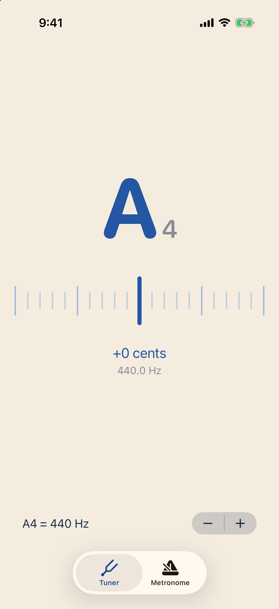
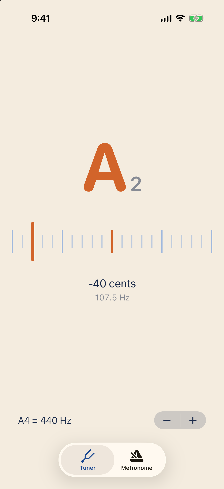
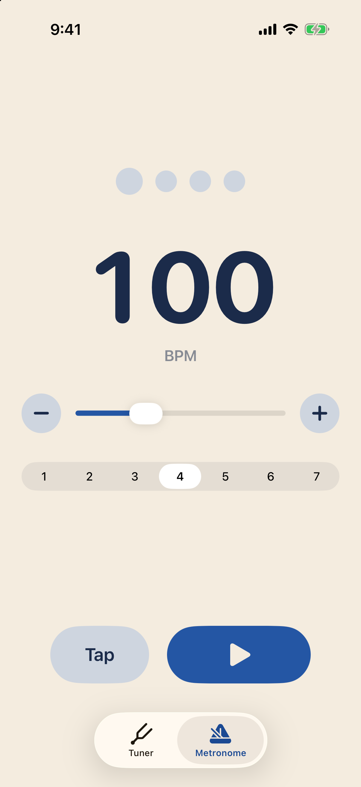

# Open Tuner

A simple, free iPhone tuner and metronome. No ads, no accounts, no tracking.

  
  
  

- **Tuner** — chromatic, works for any instrument or voice (~38 Hz to 2 kHz). Shows note, octave, frequency and a cents needle; adjustable reference pitch (A4 = 430–450 Hz). Pitch detection uses the YIN algorithm.
- **Metronome** — 30–260 BPM, 1–7 beats per bar with an accented downbeat, tap tempo, keeps playing with the screen locked.

Built with SwiftUI and AVAudioEngine. Requires iOS 17+.

## Install on your iPhone

1. Open `OpenTuner.xcodeproj` in Xcode.
2. Select the **OpenTuner** target → *Signing & Capabilities* → choose your team and change the bundle identifier to something unique.
3. Plug in your iPhone, pick it as the run destination, and press ⌘R.

## License

MIT
